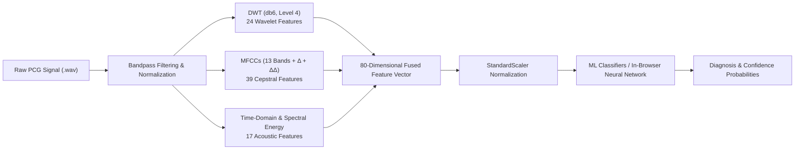

# 🩺 `pcg-hvd-classifier`

[](https://titas8100.github.io/pcg-hvd-classifier/)
[](https://www.python.org/)
[](https://developer.mozilla.org/en-US/docs/Web/API/Web_Audio_API)
[](LICENSE)

> **Automated Phonocardiogram (PCG) Signal Processing & Machine Learning Classification of Heart Valve Diseases (HVD)** using Discrete Wavelet Transform (DWT), Mel-Frequency Cepstral Coefficients (MFCCs), Spectral Feature Fusion, and Client-Side In-Browser Neural Network Inference.

---

## 🌐 Live Interactive Web Application

Experience real-time heart sound diagnostics directly in your web browser with **zero backend dependencies**:

👉 **[Launch Live Web Demo](https://titas8100.github.io/pcg-hvd-classifier/)**

---

## 📌 Overview

Heart Valve Diseases (HVD) affect millions globally. While echocardiography is the gold standard for clinical confirmation, phonocardiography (PCG) provides an accessible, non-invasive, and cost-effective screening tool. 

`pcg-hvd-classifier` provides an end-to-end system consisting of:
1. **Machine Learning Pipeline (Python):** Signal pre-processing, multi-domain feature extraction (DWT + MFCC + Time-Frequency Energy), feature selection, and benchmarking across 8 ML/DL architectures.
2. **Interactive In-Browser Diagnostic Dashboard:** Built with Vanilla HTML5/CSS3/JavaScript, leveraging the Web Audio API for client-side DSP, interactive waveform/spectrogram rendering, and neural network inference running 100% in the browser.

---

## 🫀 Supported Diagnostic Classes

The model accurately distinguishes between **Normal** heart sounds and **4 major Heart Valve Pathologies**:

| Class | Heart Condition | Clinical Acoustic Description |
| :---: | :--- | :--- |
| **`N`** | **Normal Heart Sound** | Clear S1 and S2 heart sounds with no systolic/diastolic murmurs. |
| **`AS`** | **Aortic Stenosis** | Harsh crescendo-decrescendo systolic ejection murmur best heard in the aortic area. |
| **`MR`** | **Mitral Regurgitation** | High-frequency holosystolic/pansystolic blowing murmur radiating to the axilla. |
| **`MS`** | **Mitral Stenosis** | Low-frequency diastolic rumbling murmur with opening snap (OS). |
| **`MVP`** | **Mitral Valve Prolapse** | Mid-systolic click frequently followed by a late-systolic murmur. |

---

## 🔬 Methodology & Feature Engineering



### 1. Signal Pre-processing
* Resampling and normalization of heart sound records.
* Butterworth bandpass filtering (20 Hz – 1000 Hz) to eliminate baseline wander and high-frequency acoustic artifacts.

### 2. Multi-Domain Feature Extraction (80-D Fused Vector)
* **Discrete Wavelet Transform (DWT - 24 Features):** Decomposed using Daubechies 6 (`db6`) wavelets up to Level 4 ($A_4, D_4, D_3, D_2, D_1$), computing statistical moments, variance, energy, and entropy across sub-bands.
* **Mel-Frequency Cepstral Coefficients (MFCCs - 39 Features):** Captures spectral envelopes and human psychoacoustic timbre, with delta and delta-delta dynamics.
* **Acoustic & Spectral Descriptors (17 Features):** Spectral centroid, spectral roll-off, spectral flux, zero-crossing rate (ZCR), RMS energy, and root-mean-square peak variations.

---

## 📊 Benchmark & Experimental Results

Evaluated across **1,000 heart sound recordings** (200 samples per class) using 10-fold Stratified Cross-Validation:

| Model Architecture | Accuracy (Mean ± Std) | Macro F1-Score | Precision | Recall |
| :--- | :---: | :---: | :---: | :---: |
| 🥇 **Extra Trees Classifier** | **99.60% ± 0.66%** | **99.60%** | **99.63%** | **99.60%** |
| 🥈 **Random Forest (300 Trees)** | **98.90% ± 1.14%** | **98.90%** | **98.96%** | **98.90%** |
| 🥉 **Gradient Boosting (GBDT)** | **98.60% ± 0.92%** | **98.60%** | **98.68%** | **98.60%** |
| 🔹 **Tuned RBF SVM** | **98.20% ± 0.98%** | **98.20%** | **98.33%** | **98.20%** |
| 🔹 **Multi-Layer Perceptron (MLP)** | **97.90% ± 1.37%** | **97.90%** | **97.99%** | **97.90%** |
| 🔹 **Quadratic SVM (Baseline)** | **96.40% ± 1.62%** | **96.39%** | **96.58%** | **96.40%** |
| 🔹 **PyTorch 1D-CNN (End-to-End)** | **96.33% (Holdout)** | **96.33%** | **96.33%** | **96.33%** |
| 🔹 **KNN ($k=5$, Distance-Weighted)** | **96.30% ± 2.28%** | **96.31%** | **96.51%** | **96.30%** |

---

## 💻 Tech Stack

* **Machine Learning & Signal Processing:** Python, PyTorch, Scikit-Learn, PyWavelets (`pywt`), Librosa, SciPy, NumPy, Pandas.
* **Frontend Web Application:** Vanilla HTML5, Modern CSS3 (Glassmorphism, CSS Custom Properties, Dark Mode), Web Audio API, Canvas API.
* **Model Serialization:** JSON-based weights and scalar parameters running ultra-fast vector matrix multiplications in pure JavaScript.

---

## 📂 Repository Structure

```text
pcg-hvd-classifier/
├── data/
│   ├── raw/                  # Raw PCG WAV recordings across 5 classes (AS, MR, MS, MVP, N)
│   └── features/             # Extracted DWT, MFCC, and 80-D enhanced numpy feature arrays
├── docs/                     # GitHub Pages deployment bundle
│   ├── index.html            # Web app entry point
│   ├── app.js                # In-browser Web Audio DSP & ML inference engine
│   ├── style.css             # Glassmorphism aesthetic UI styling
│   ├── model_weights.json    # Trained neural network architecture & weights
│   └── samples/              # Pre-loaded heart sound audio samples for quick demo testing
├── notebooks/
│   └── Heart_Valve_Disease_PCG_ML.ipynb # Jupyter notebook for interactive research
├── results/
│   ├── figures/              # Confusion matrices, ROC curves, spectrograms, comparisons
│   └── tables/               # CSV benchmarks and reproduced literature comparisons
├── src/
│   ├── data_loader.py        # Dataset loading & preprocessing
│   ├── features_dwt.py       # Discrete Wavelet Transform extraction
│   ├── features_mfcc.py      # MFCC and spectral extraction
│   ├── features_enhanced.py  # 80-D feature fusion pipeline
│   ├── models_advanced.py    # Classifiers training & hyperparameter tuning
│   ├── experiments_report.py # Automated statistical reporting
│   └── visualization.py      # Plotting waveforms, spectrograms, and matrices
├── index.html                # Root web dashboard
├── app.js                    # Root application JavaScript
├── style.css                 # Root styles
├── requirements.txt          # Python dependencies
└── README.md                 # Project documentation
```

---

## 🚀 Getting Started

### 1. Running the Web App Locally

You can run the web application using any lightweight HTTP server:

```bash
# Clone the repository
git clone https://github.com/Titas8100/pcg-hvd-classifier.git
cd pcg-hvd-classifier

# Start a local web server (Python 3)
python -m http.server 8000
```
Then open `http://localhost:8000` in your web browser.

---

### 2. Python ML Pipeline & Training

#### Prerequisites
Install the required dependencies:
```bash
pip install -r requirements.txt
```

#### Run Full Feature Extraction & Model Benchmarking
```bash
# Run the complete pipeline
python run_pipeline.py

# Export web model weights and samples
python export_web_assets.py
```

---

## 🌐 Enabling GitHub Pages (Hosting Guide)

To host your own live instance of this app for free on GitHub Pages:

1. Go to your repository on GitHub: `https://github.com/Titas8100/pcg-hvd-classifier`
2. Click **Settings** (top tabs) > **Pages** (left sidebar).
3. Under **Build and deployment** > **Branch**:
   * Select branch: **`main`**
   * Select folder: **`/docs`** (or **`/ (root)`**)
4. Click **Save**.
5. Within 1–2 minutes, your live site will be accessible at:
   **`https://Titas8100.github.io/pcg-hvd-classifier/`**

---

## 📜 References & Acknowledgments

1. **Dataset Reference:** Heart sound signal benchmark recordings adapted from clinical PCG datasets ([Ref: Yaseen et al.](https://github.com/yaseen21khan/Classification-of-Heart-Sound-Signal-Using-Multiple-Features-)).
2. **Signal Processing Standards:** Daubechies wavelets (`db6`) and Mel-Scale Filterbanks according to standard biomedical signal analysis literature.

---

## 📄 License

This project is licensed under the [MIT License](LICENSE) - open for academic, educational, and research use.
